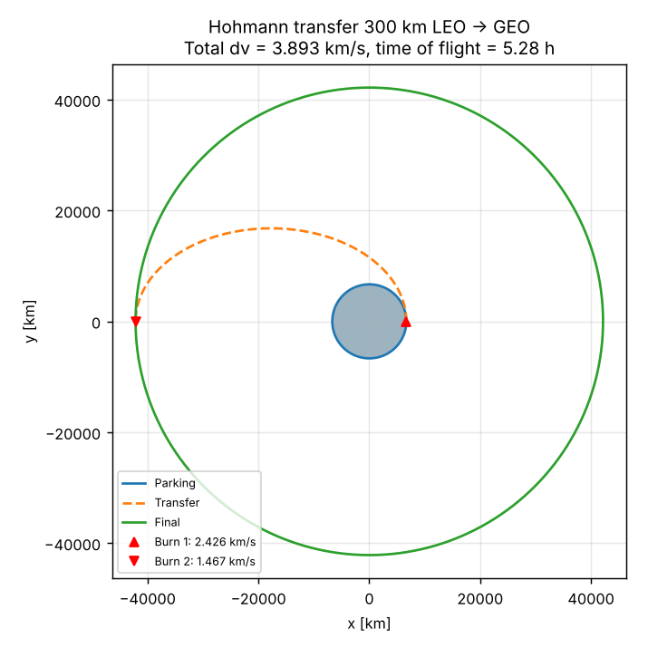
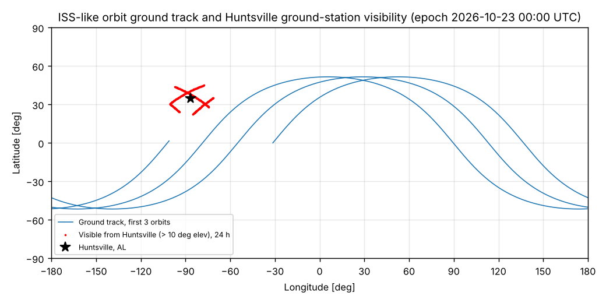

# Orbit-Sim: An Earth-Orbit Flight Dynamics Simulator

**Jason Jenkins** · B.S. Physics with Astrophysics, University of Alabama in Huntsville

**[▶ Run the live 3D simulator](https://pqc-sentinel.github.io/Orbit-Sim/web/orbitsim.html)** (no install needed; runs in any browser)

Orbit-Sim is an orbital mechanics simulator I built to model how satellites move around Earth, how they change orbits, and when they can be seen from the ground. It has two parts: a Python engine for analysis and testing, and an interactive 3D simulator that runs in any web browser.



## What it does

- **Propagates orbits** by numerically integrating the equations of motion. It starts with Earth's gravity and then adds the two effects that matter most in low Earth orbit. The first is J2, Earth's equatorial bulge, which slowly rotates an orbit's plane. The second is atmospheric drag, which pulls satellites down over time.
- **Plans and flies Hohmann transfers**, the fuel-efficient two-burn maneuver used to raise a satellite from low Earth orbit to geostationary orbit. It calculates the delta-v (3.893 km/s from 300 km to GEO) and the time of flight, then simulates the burns.
- **Models CubeSat orbit decay.** A 1U CubeSat released at 350 km re-enters the atmosphere after about 66 days. This connects directly to my work on the 1U frame for UAH's Trantor CubeSat.
- **Draws ground tracks and predicts ground-station passes.** It maps the satellite's path over Earth and predicts when it will be visible from Huntsville, Alabama: how long each pass lasts and how high it climbs in the sky.
- **Verifies its own accuracy.** An automated suite of 11 tests checks every model against textbook and analytic results from Curtis and Vallado:
  - energy is conserved to 3 parts in 100 billion
  - the J2 drift matches theory within 0.5%
  - the Hohmann delta-v matches the textbook
  - the Python and browser versions, which use different integration methods, predict the same Huntsville pass times to the minute



## Why I built it

I have been fascinated by space for as long as I can remember: rockets, satellites, astronomy, and the physics that ties them together. That passion is why I went back to school and earned my B.S. in Physics with an Astrophysics focus from the University of Alabama in Huntsville. Along the way I worked on CubeSat hardware with the UAH Space Hardware Club, analyzed International Space Station data in NASA-supported plasma research, and trained in digital engineering at the UTEP Aerospace Center.

I built Orbit-Sim because I wanted to go beyond solving orbital mechanics problems on paper. I wanted a working flight dynamics tool that I could test, trust, and explain. Every number it produces has been checked, because that is how real aerospace engineering works: you prove your model before anyone flies on it. Living near Huntsville, the Rocket City, I also wanted it to answer a local question: when can a satellite overhead actually be seen from here?

I built Orbit-Sim with the help of an AI coding assistant and verified every model myself against standard references. It reflects how I want to work as an engineer: curious, hands-on, and rigorous about getting the physics right.

**Built with:** Python, NumPy, SciPy, Matplotlib, pytest, JavaScript, three.js

---

## Quick start

```bash
pip install numpy scipy matplotlib pytest
python -m pytest -q          # 11 verification tests
python run_all.py            # runs every scenario, writes plots + summary.json to results/
```

To use the browser version, open the [live simulator](https://pqc-sentinel.github.io/Orbit-Sim/web/orbitsim.html) or open `web/orbitsim.html` locally.

## Project structure

| Module | Capability |
|---|---|
| `orbitsim/elements.py` | State vector to/from classical orbital elements; Kepler's-equation analytic propagation |
| `orbitsim/dynamics.py` | Two-body, J2 and drag accelerations; piecewise exponential atmosphere (Vallado Table 8-4) |
| `orbitsim/propagate.py` | Hand-written fixed-step RK4 and adaptive Dormand-Prince 8(5,3) (SciPy) with a re-entry stop event |
| `orbitsim/maneuvers.py` | Hohmann transfer planning (delta-v, time of flight) and a numerically flown transfer with impulsive burns |
| `orbitsim/groundtrack.py` | GMST Earth rotation, ECI to ECEF, ground track, WGS-84 ground station, elevation/azimuth/range, pass finder |
| `tests/test_orbitsim.py` | 11 verification tests |
| `run_all.py` | Runs every scenario and saves the plots in `results/` |
| `web/orbitsim.html` | Interactive 3D simulator (three.js) |

## Results

| Scenario | Result |
|---|---|
| Hohmann 300 km LEO to GEO | dv1 = 2.4257 km/s, dv2 = 1.4668 km/s, total 3.8926 km/s, time of flight 5.275 h |
| 1U CubeSat (1.33 kg, 0.01 m², Cd 2.2) from 350 km | Re-entry (120 km) after about 66 days, average solar activity |
| ISS-like orbit, 24 h from 2026-10-23 00:00 UTC | 4 Huntsville passes above 10°; best is 6.6 min at 54° max elevation |
| Sun-synchronous 800 km, i = 98.6° | RAAN drifts +0.99°/day, matching the Sun's apparent motion |

## Verification and validation

| Check | Reference | Simulated | Pass criterion |
|---|---|---|---|
| Energy conservation, 10 orbits (DOP853) | 0 | 3.3e-11 relative | < 1e-9 |
| Angular momentum conservation | 0 | < 1e-9 relative | < 1e-9 |
| Numerical vs Kepler's equation, 3 orbits, e = 0.3 | 0 km | < 0.001 km | < 1 m |
| RK4 convergence order | 4 | 4.21 | ratio 12–20 when dt halves |
| J2 nodal regression, SSO 800 km | 0.9853°/day | 0.9895°/day | within 2% |
| J2 nodal regression, 420 km, 51.6° | −4.951°/day | −4.972°/day | within 2% |
| Hohmann 300 km to GEO total delta-v | 3.893 km/s (textbook) | 3.8926 km/s | within 0.005 km/s |
| Hohmann final orbit circularity | r = 42,164 km | error < 0.0001 km | < 0.5 km |
| Drag decay rate, 300 km | analytic da/dt with co-rotating air | within 3% | within 3% |
| GMST | 152.578788° (Vallado Ex. 3-5) | 152.5788° | within 0.001° |
| State vector to elements | Curtis Ex. 4.3 | matches | within 0.1° |
| Overhead satellite look angle | 90° elevation | 90° | within 0.3° |

The browser simulator (JavaScript RK4) independently predicts the same four Huntsville pass times as the Python DOP853 reference, to the minute.

## Assumptions and limitations

- Gravity: point mass plus J2 only; no higher harmonics, Sun/Moon third-body gravity or solar radiation pressure.
- Atmosphere: static exponential model for average solar activity; real decay is faster near solar maximum.
- Burns are impulsive (instantaneous delta-v).
- Ground-track latitude is geocentric; the ground station uses the WGS-84 ellipsoid.
- The ISS-like orbit uses representative elements, not a live ISS ephemeris (TLE).

## What's next

SGP4/TLE input for real satellites, Sun/Moon perturbations, an NRLMSISE-00 atmosphere, finite-burn maneuvers, Lambert's problem for rendezvous, and a Monte Carlo study of how uncertain drag coefficients change CubeSat lifetime.

## References

- H. Curtis, *Orbital Mechanics for Engineering Students*, 4th ed.
- D. Vallado, *Fundamentals of Astrodynamics and Applications*, 4th ed.
